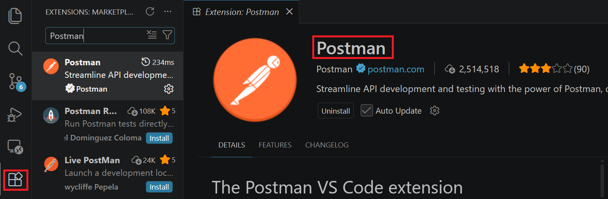

# Postman Extension으로 FastAPI 테스트

---
## 학습 목표

- VS Code의 Postman Extension으로 API 요청을 보내고 응답을 검증할 수 있다
- FastAPI가 제공하는 `openapi.json`을 가져와 Collection을 만들 수 있다
- Environment 변수로 서버 주소와 인증 토큰을 관리할 수 있다
- Tests와 Pre-request Script로 반복 테스트를 자동화할 수 있다

---
## [Postman](https://www.postman.com/)

| 항목 | 설명 |
|---|---|
| Postman | API를 테스트하고 관리할 수 있는 API 개발 도구 |
| 주요 기능 | API 요청 전송, 응답 확인, 자동 테스트 |
| 지원 방식 | REST, GraphQL, WebSocket 등 |
| 장점 | 코드 없이 API 테스트 가능, 협업 기능 제공 |
| 단점 | 복잡한 자동화에는 별도 설정 필요 |
| 주요 사용처 | 백엔드 개발, 프론트엔드 연동 테스트, API 문서 검증 |

---
## 1. 현재 프로젝트 API 구조

| 기능 | Method | Path | 인증 | 확인 포인트 |
|------|--------|------|------|-------------|
| 서버 상태 확인 | GET | `/health` | 없음 | 서버 실행 여부와 버전 확인 |
| 상품 목록 조회 | GET | `/products` | 없음 | `category`, `page`, `size` 쿼리 파라미터 |
| 상품 등록 | POST | `/products` | 필요 | Bearer 토큰, 중복 상품명, 201 응답 |

---
| 기능 | Method | Path | 인증 | 확인 포인트 |
|------|--------|------|------|-------------|
| 상품 단건 조회 | GET | `/products/{product_id}` | 없음 | 존재하지 않는 ID는 404 |
| 상품 부분 수정 | PATCH | `/products/{product_id}` | 없음 | 전달한 필드만 수정 |
| 상품 삭제 | DELETE | `/products/{product_id}` | 없음 | 성공 시 204, 본문 없음 |
| 주문 생성 | POST | `/orders` | 없음 | 재고 확인, 재고 차감, 총액 계산 |
| 주문 조회 | GET | `/orders/{order_id}` | 없음 | 생성된 주문 ID로 조회 |

---
| 기능 | Method | Path | 인증 | 확인 포인트 |
|------|--------|------|------|-------------|
| 회원 가입 | POST | `/users` | 없음 | 이메일 중복 확인 |
| 내 정보 조회 | GET | `/users/me` | 필요 | Bearer 토큰으로 보호된 요청 테스트 |

> 실습용 관리자 토큰은 다음 값입니다.

```text
demo-admin-token
```

---
## 2. Postman 앱 설치 없이 사용하기
> VS Code 안에서 실행되는 **Postman Extension**만 사용합니다.

1. VS Code 왼쪽의 **Extensions** 패널을 엽니다.
2. `Postman`을 검색합니다.
3. Postman Extension을 활성화합니다.
4. VS Code 왼쪽 Activity Bar에서 Postman 아이콘을 열어 요청을 만들거나 Collection을 가져옵니다.

---
> 정리하면, PC에 Postman 앱을 따로 설치하는 방식이 아니라 VS Code 확장 화면에서 Postman 기능을 열어 사용하는 방식입니다.



---
## 3. FastAPI 서버 실행

현재 폴더에서 서버를 실행합니다.

```bash
uvicorn main:app --reload --port 8001 
```

`uv` 환경을 사용한다면 다음 명령도 사용할 수 있습니다.

```bash
uv run uvicorn main:app --reload --port 8001
```

---
실행 후 다음 주소를 확인합니다.

| 주소 | 용도 |
|------|------|
| `http://localhost:8001/health` | 서버 상태 확인 |
| `http://localhost:8001/docs` | Swagger UI |
| `http://localhost:8001/openapi.json` | Postman Import에 사용할 OpenAPI 스펙 |

> `main.py`는 `ENV=production`일 때 `/docs`, `/redoc`, `/openapi.json`을 비활성화합니다. 실습에서는 기본값인 개발 환경으로 실행합니다.

---
## 4. OpenAPI 스펙 가져오기

FastAPI는 `/openapi.json`에서 전체 API 스펙을 제공합니다. Postman Extension에 이 스펙을 가져오면 엔드포인트가 Collection으로 자동 생성됩니다.

---
### URL로 가져오기

1. FastAPI 서버를 실행합니다.
2. Postman Extension에서 **Import**를 선택합니다.
3. URL 입력 방식이 있다면 다음 주소를 입력합니다.

```text
http://localhost:8001/openapi.json
```

4. Import를 완료한 뒤 생성된 요청 목록을 확인합니다.

---
### Raw text로 가져오기

1. 브라우저에서 `http://localhost:8001/openapi.json`에 접속합니다.
2. JSON 전체를 복사합니다.
3. Postman Extension의 **Import**에서 Raw text 영역에 붙여넣습니다.
4. Import를 완료합니다.

현재 폴더의 `collection.json` 파일을 직접 Import해도 됩니다.

---
## 5. Environment 변수 설정

요청마다 서버 주소와 토큰을 직접 입력하지 않도록 Environment 변수를 만듭니다.

| Variable | Initial Value | Current Value |
|----------|---------------|---------------|
| `base_url` | `http://localhost:8001` | `http://localhost:8001` |
| `token` | `demo-admin-token` | `demo-admin-token` |
| `product_id` | `1` | `1` |
| `order_id` | `1` | `1` |
| `product_name` | `테스트 상품` | `테스트 상품` |

---
요청 URL과 Header에서 다음처럼 사용합니다.

```http
GET {{base_url}}/products/{{product_id}}
Authorization: Bearer {{token}}
```

> 인증이 필요한 요청은 현재 구현 기준으로 `POST /products`, `GET /users/me`입니다.

---
## 6. 기본 요청 실습

---
### 서버 상태 확인

```text
Method : GET
URL    : {{base_url}}/health
```

예상 응답에는 `status`, `version`, `timestamp`가 포함됩니다.

---
### 상품 목록 조회

```text
Method : GET
URL    : {{base_url}}/products
Params : page=1, size=10
```

카테고리 필터를 확인하려면 `category=전자제품`을 추가합니다.

---
### 상품 등록

`POST /products`는 관리자 토큰이 필요합니다.

```text
Method  : POST
URL     : {{base_url}}/products
Headers : Authorization: Bearer {{token}}
Body    : raw / JSON
```

```json
{
    "name": "{{product_name}}",
    "price": 45000,
    "stock": 30,
    "category": "전자제품"
}
```

`main.py`에는 이미 `무선 마우스`, `기계식 키보드`가 들어 있습니다. 같은 이름으로 상품을 등록하면 409 응답이 발생하므로 실습에서는 고유한 상품명을 사용합니다.

---
### 상품 수정

```text
Method : PATCH
URL    : {{base_url}}/products/{{product_id}}
Body   : raw / JSON
```

```json
{
    "price": 39000,
    "stock": 25
}
```

---
### 주문 생성

```text
Method : POST
URL    : {{base_url}}/orders
Body   : raw / JSON
```

```text
{
    "items": [
        {
            "product_id": {{product_id}},
            "quantity": 1
        }
    ]
}
```

Postman이 요청을 보내기 전에 `{{product_id}}`를 실제 숫자 값으로 치환합니다.

주문 생성에 성공하면 상품 재고가 자동으로 차감되고, 응답의 `id`를 `order_id` 변수에 저장해 다음 조회 요청에서 사용합니다.

---
### 회원 가입

```text
Method : POST
URL    : {{base_url}}/users
Body   : raw / JSON
```

```json
{
    "username": "testuser",
    "email": "test@example.com",
    "password": "pass1234"
}
```

---
## 7. Collection 구성 예시

```text
├── Health
│   └── 서버 상태 확인                 GET    /health
│
├── Products
│   ├── 상품 목록 조회                 GET    /products
│   ├── 상품 등록                      POST   /products
│   ├── 상품 단건 조회                 GET    /products/{{product_id}}
│   ├── 상품 부분 수정                 PATCH  /products/{{product_id}}
│   └── 상품 삭제                      DELETE /products/{{product_id}}
│
├── Orders
│   ├── 주문 생성                      POST   /orders
│   └── 주문 조회                      GET    /orders/{{order_id}}
│
├── Users
│   ├── 회원 가입                      POST   /users
│   └── 내 정보 조회                   GET    /users/me
│
└── Error Cases
    ├── 존재하지 않는 상품 조회         GET    /products/99999
    └── 필수 필드 누락                 POST   /products
```

---
## 8. 에러 케이스 테스트

### 존재하지 않는 상품

```text
GET {{base_url}}/products/99999
```

예상 상태 코드는 404입니다.

---
### 재고 초과 주문

```json
{
    "items": [
        {
            "product_id": 1,
            "quantity": 99999
        }
    ]
}
```

예상 상태 코드는 400이고, 응답 detail에는 `INSUFFICIENT_STOCK` 정보가 포함됩니다.

### 토큰 없이 상품 등록

`Authorization` 헤더를 제거한 뒤 `POST /products`를 실행합니다.

예상 상태 코드는 401입니다.

---
### 잘못된 토큰

```http
Authorization: Bearer wrong-token
```

예상 상태 코드는 403입니다.


### 필수 필드 누락

인증 헤더는 유지하고 Body에서 `name` 또는 `price` 같은 필수 필드를 제거합니다.

예상 상태 코드는 422입니다.

---
## 9. Collection Runner로 전체 실행

1. Postman Extension에서 Collection을 선택합니다.
2. 실행할 Environment를 `Local Development`로 선택합니다.
3. 요청 순서를 확인합니다.
4. Collection Runner를 실행합니다.
5. Tests 결과를 확인합니다.

---
추천 실행 순서:

```text
1. GET  /health
2. GET  /products
3. POST /products
4. GET  /products/{{product_id}}
5. PATCH /products/{{product_id}}
6. POST /orders
7. GET  /orders/{{order_id}}
8. POST /users
9. GET  /users/me
10. Error Cases
```

`DELETE /products/{{product_id}}`는 뒤에서 해당 상품을 다시 조회하거나 주문에 사용할 수 없으므로 마지막에 실행합니다.

---
## 10. collection.json 사용

현재 폴더에는 바로 Import할 수 있는 `collection.json`이 있습니다.

```text
1. Postman Extension 열기
2. Import 선택
3. 현재 폴더의 collection.json 선택
4. Environment에서 base_url, token 확인
5. FastAPI 서버 실행 후 요청 전송
```

팀원에게 공유할 때도 Collection을 JSON으로 Export하면 됩니다.

---
## 실습 순서

1. 현재 폴더에서 `uvicorn main:app --reload --port 8001`로 서버 실행
2. Postman Extension 열기
3. `http://localhost:8001/openapi.json` 또는 `collection.json` Import
4. Environment 변수 `base_url`, `token` 설정
5. `GET /health`로 서버 상태 확인
6. 상품 등록, 조회, 수정 요청 실행
7. 주문 생성 후 `order_id` 저장
8. 회원 가입과 `GET /users/me` 인증 요청 실행
9. Tests와 Pre-request Script 추가
10. Collection Runner로 전체 시나리오 실행

---
## 핵심 정리

| 기능 | 방법 |
|------|------|
| Postman 사용 | 데스크톱 앱 대신 VS Code Postman Extension 사용 |
| API 스펙 가져오기 | `/openapi.json` 또는 `collection.json` Import |
| 환경 분리 | Environment 변수 `{{base_url}}`, `{{token}}` |
| 인증 토큰 전달 | `Authorization: Bearer {{token}}` |
| 응답 자동 검증 | Tests 탭 + `pm.test()` |
| 요청 전 데이터 생성 | Pre-request Script |
| 시나리오 테스트 | Collection Runner |
| 팀 공유 | Collection Export / Import |
