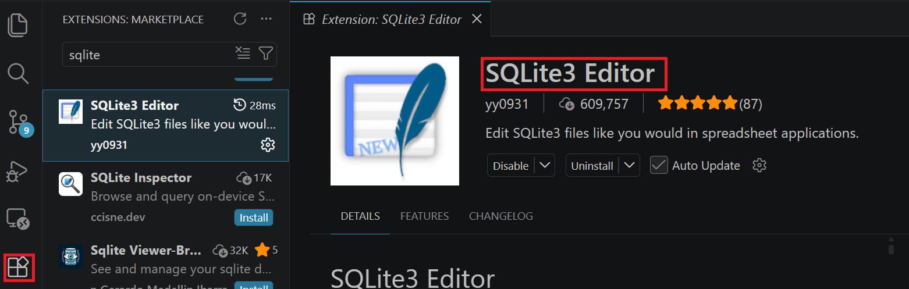

# CRUD 기반 백엔드 서비스 설계
- `C(Create)`: 생성
- `R(Read)`: 조회
- `U(Update)`: 수정
- `D(Delete)`: 삭제

---
## 학습 목표

- 3계층 아키텍처(Router → Service → Repository)를 이해하고 구조화
- SQLite로 서버 재시작 후에도 남는 CRUD API 구현
- Create / Update / Response 스키마 분리 원칙 적용
- 의존성 주입(Depends)으로 테스트 가능한 코드 구조 설계

---
## 왜 SQLite를 쓰는가?

| 선택지 | 특징 |
|------|------|
| 인메모리 저장소 | 구조 설명은 쉽지만 서버 재시작 시 데이터가 사라짐 |
| SQLite | 별도 DB 서버 없이 실제 파일에 데이터 저장 |
| PostgreSQL/MySQL | 실무적이지만 초반 설정 부담이 큼 |
| ORM | 편리하지만 CRUD 첫 수업에서는 개념이 많아질 수 있음 |

이번 수업은 CRUD와 계층 분리에 집중하기 위해 표준 라이브러리 `sqlite3`를 사용합니다.

---
## 1. 백엔드 서비스 계층 구조

---
### 왜 계층을 나누는가?

| 문제 | 해결 |
|------|------|
| 라우터에 SQL이 섞여 유지보수 어려움 | Repository 계층으로 DB 접근 격리 |
| 비즈니스 로직이 흩어짐 | Service 계층으로 로직 집중 |
| 단위 테스트가 어려움 | 계층별 독립 테스트 가능 |
| 저장소 교체 시 전면 수정 | Repository 중심으로 수정 범위 축소 |

---
### 3계층 구조

```
[클라이언트]
     ↓ HTTP 요청/응답
┌─────────────────────────────┐
│  Router (Presentation)      │  Pydantic 검증, 상태코드, 직렬화
└────────────┬────────────────┘
             ↓
┌─────────────────────────────┐
│  Service (Business Logic)   │  유효성 검사, 규칙 처리
└────────────┬────────────────┘
             ↓
┌─────────────────────────────┐
│  Repository (Data Access)   │  SQL 실행, DB CRUD
└────────────┬────────────────┘
             ↓
          SQLite
```

---
### 각 계층의 책임

```python
# Router - HTTP 요청/응답만 담당
@app.get("/posts/{post_id}", response_model=PostResponse)
def get_post(post_id: int, service: PostService = Depends(get_post_service)):
    return service.get_post(post_id)

# Service - 비즈니스 규칙 담당
class PostService:
    def get_post(self, post_id: int) -> dict:
        post = self.repo.get_by_id(post_id)
        if not post:
            raise HTTPException(404, "게시글을 찾을 수 없습니다")
        return post

# Repository - SQL과 DB 접근 담당
class PostRepository:
    def get_by_id(self, post_id: int) -> dict | None:
        row = self.db.execute("SELECT * FROM posts WHERE id = ?", (post_id,)).fetchone()
        return dict(row) if row else None
```

---
## 2. 도메인 모델 설계

---
### 예제: 블로그 API

```
Category (카테고리)
  └── id, name, description

Post (게시글)
  └── id, title, content, summary, published
  └── category_id → Category  (N:1)
  └── created_at, updated_at

Comment (댓글)
  └── id, content, author
  └── post_id → Post  (N:1)
  └── created_at
```

---
### 관계 다이어그램

```
Category (1) ────< Post (1) ────< Comment
```

### 관계 설계 결정 사항

| 관계 | 설계 선택 |
|------|----------|
| Category → Post | `posts.category_id`에 외래키 저장 |
| Category 삭제 시 | 게시글은 유지하고 `category_id`를 `NULL`로 변경 |
| Post → Comment | `comments.post_id`에 외래키 저장 |
| Post 삭제 시 | Comment도 함께 삭제 |

---
## [3. SQLite 테이블 설계](https://sqlite.org/)
| 항목 | 설명 |
|---|---|
| SQLite | 별도의 서버 없이 파일 하나로 동작하는 경량 관계형 데이터베이스(RDBMS) |
| 특징 | 설치 및 설정이 거의 필요 없음 |
| 데이터 저장 방식 | `.db` 파일 하나에 모든 데이터를 저장 |
| 사용 언어 | SQL 지원 |
| 장점 | 가볍고 빠르며 배포가 쉬움 |
| 단점 | 대규모 동시 접속 환경에는 부적합 |

---
### Extension 추가 



---
### DB 연결 설정

```python
from pathlib import Path
import sqlite3
from typing import Iterator

DATABASE_PATH = Path("blog.db")

def get_db() -> Iterator[sqlite3.Connection]:
    conn = sqlite3.connect(DATABASE_PATH, check_same_thread=False)
    conn.row_factory = sqlite3.Row
    conn.execute("PRAGMA foreign_keys = ON")
    try:
        yield conn
    finally:
        conn.close()
```

---
### 테이블 생성

```python
def init_db() -> None:
    with sqlite3.connect(DATABASE_PATH) as conn:
        conn.execute("PRAGMA foreign_keys = ON")
        conn.executescript("""
        CREATE TABLE IF NOT EXISTS categories (
            id INTEGER PRIMARY KEY AUTOINCREMENT,
            name TEXT NOT NULL UNIQUE,
            description TEXT
        );

        CREATE TABLE IF NOT EXISTS posts (
            id INTEGER PRIMARY KEY AUTOINCREMENT,
            title TEXT NOT NULL,
            content TEXT NOT NULL,
            summary TEXT,
            published INTEGER NOT NULL DEFAULT 0,
            category_id INTEGER,
            created_at TEXT NOT NULL,
            updated_at TEXT NOT NULL,
            FOREIGN KEY (category_id)
                REFERENCES categories(id)
                ON DELETE SET NULL
        );
        """)
```

---
### SQLite 설계 포인트

| 기능 | 설명 |
|------|------|
| `INTEGER PRIMARY KEY AUTOINCREMENT` | 자동 증가 ID |
| `UNIQUE` | 카테고리 이름 중복 방지 |
| `FOREIGN KEY` | 테이블 간 관계 보장 |
| `ON DELETE CASCADE` | 게시글 삭제 시 댓글 함께 삭제 |
| `ON DELETE SET NULL` | 카테고리 삭제 시 게시글은 유지 |
| `CREATE INDEX` | 자주 검색하는 컬럼 조회 성능 개선 |

---
## 4. Pydantic 스키마 설계

---
### Create / Update / Response 분리

```python
class PostCreate(BaseModel):
    title: str = Field(..., max_length=200)
    content: str
    category_id: int | None = None

class PostUpdate(BaseModel):
    title: str | None = Field(None, max_length=200)
    content: str | None = None
    summary: str | None = None
    published: bool | None = None
    category_id: int | None = None

class PostResponse(BaseModel):
    id: int
    title: str
    content: str
    summary: str | None
    published: bool
    created_at: datetime
    updated_at: datetime
```

---
### 스키마 목적별 규칙

| 스키마 | 특징 |
|--------|------|
| `XxxCreate` | 클라이언트가 새로 만들 때 보내는 값 |
| `XxxUpdate` | 일부 필드만 수정 가능 |
| `XxxResponse` | 서버가 응답으로 내려주는 값 |

---
### `exclude_unset=True` 의 중요성

```python
data = PostUpdate(title="새 제목")  # content는 전달하지 않음

data.model_dump()
# {"title": "새 제목", "content": None, ...}

data.model_dump(exclude_unset=True)
# {"title": "새 제목"}
```

전달하지 않은 필드를 `NULL`로 덮어쓰지 않기 위해 사용합니다.

---
## 5. Repository 패턴

```python
class PostRepository:
    def __init__(self, db: sqlite3.Connection):
        self.db = db

    def get_by_id(self, post_id: int) -> dict | None:
        row = self.db.execute(
            "SELECT * FROM posts WHERE id = ?",
            (post_id,),
        ).fetchone()
        return dict(row) if row else None

    def create(self, data: PostCreate) -> dict:
        cursor = self.db.execute(
            "INSERT INTO posts (title, content) VALUES (?, ?)",
            (data.title, data.content),
        )
        self.db.commit()
        return self.get_by_id(cursor.lastrowid)
```

---
### Repository에서 지켜야 할 점

| 원칙 | 이유 |
|------|------|
| SQL은 Repository 안에 둔다 | 라우터와 서비스가 DB 문법에 오염되지 않음 |
| `?` 플레이스홀더를 쓴다 | SQL Injection 방지 |
| 변경 후 `commit()` 한다 | INSERT/UPDATE/DELETE 결과 저장 |
| 조회 결과를 dict로 바꾼다 | Pydantic 응답 모델과 연결하기 쉬움 |

---
## 6. Service 패턴

```python
class PostService:
    def __init__(self, db: sqlite3.Connection):
        self.repo = PostRepository(db)
        self.category_repo = CategoryRepository(db)

    def create_post(self, data: PostCreate) -> dict:
        if data.category_id is not None:
            category = self.category_repo.get_by_id(data.category_id)
            if not category:
                raise HTTPException(400, "존재하지 않는 카테고리입니다")
        return self.repo.create(data)
```

---
### Service에서 처리할 것

| 처리 | 예시 |
|------|------|
| 존재 여부 확인 | 없는 게시글이면 404 |
| 비즈니스 규칙 | 이미 공개된 게시글은 다시 공개 불가 |
| 관계 검증 | 없는 카테고리로 게시글 생성 불가 |
| Repository 조합 | 게시글 상세 + 카테고리 + 댓글 수 |

---
## 7. 의존성 주입

```python
def get_post_service(
    db: sqlite3.Connection = Depends(get_db),
) -> PostService:
    return PostService(db)

@app.post("/posts", response_model=PostResponse, status_code=201)
def create_post(
    data: PostCreate,
    service: PostService = Depends(get_post_service),
):
    return service.create_post(data)
```

---
## 핵심 설계 원칙 정리

| 원칙 | 적용 방식 |
|------|----------|
| 단일 책임 (SRP) | Router = HTTP, Service = 로직, Repository = DB |
| 관심사 분리 | SQL은 Repository에만 둠 |
| 스키마 목적 분리 | Create / Update / Response 분리 |
| 관계 규칙 명시 | 외래키와 삭제 정책을 테이블에 표현 |
